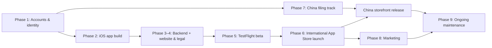
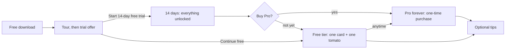

# UNTO FLOW — Publishing & Maintenance Guide (International + Mainland China)

> **v3 — low-cost, phased, with the monetization plan.** Spend only what's needed now and add paid pieces once there's demand. The monetization plan sits right after the locked decisions; the phases reference it as M1–M12.
> **Brand setup (renamed Oct 13, 2026):** the umbrella name is **UNTO** (the earlier "Fable Studio" plan was dropped over name conflicts). The app is **UNTO FLOW** (formerly Fable / Flow). UNTO's domain is **still to be chosen**, so **`<brand-domain>`** (a `.com` for UNTO) stays as a placeholder below.
> **Owners:** 🧑 = you (accounts, IDs, payments, legal) · 🤖 = me (code, configs, docs, QA).
> Prices and rules were checked in October 2026 and change over time. ⚠️ marks items to re-verify at the moment you act.

---

## Cost phases at a glance

| Phase | When | What you pay for | ≈ Cost |
|---|---|---|---|
| **A. Launch lean** | Now → international launch | Apple Developer Program **\$99/yr** + one `.com` domain (**~\$10–15/yr**) + Google Voice (free) | **≈ \$110–115 in year one** |
| **B. Traction** | A few hundred active users, ~100 paying users, or photos near the free 1 GB | Supabase Pro **\$25/mo**; optional iCloud+ email \$12/yr | +\$300–312/yr |
| **C. China** | When international shows traction and you want the mainland storefront | Mainland server (from **¥99/yr**), a filable domain if needed; filing itself is free | +~\$15–45/yr |
| **D. Protect & expand** | Brand name settled (**UNTO** ✅); once products multiply | Trademarks (CN ≈ ¥300/class, US ≈ \$350/class); P.O. box for EU privacy (optional); Google Play \$25 once | one-off |

**Free or at-cost choices used in Phase A:**
- **Supabase free tier**, kept awake by a weekly automatic check-in + weekly backup (🤖 sets up via GitHub Actions)
- **Free email** on your domain (Zoho Mail Free, or Cloudflare Email Routing → your existing inbox)
- **Google Voice** number for Apple's EU contact field
- **GitHub Pages** for the website

---

## 0. Locked decisions

| Topic | Decision |
|---|---|
| Model | Free download → optional **14-day full trial** (Apple's \$0 "14-Day Trial") → free tier (**one card + one tomato**) or **Pro, one-time: \$4.99 at launch** (China ¥25–30), raised to \$5.99–6.99 with traction. Details: Monetization plan below. |
| Extras | **Tip jar** (3 consumable tips); **50 founding beta users** get Pro via Offer Codes; no ads, no subscription |
| Platforms | iPhone first (international + China), Android (Google Play) later, China Android only with a company |
| Domain / email | **One `.com` personal-brand domain** (`<brand-domain>`, doubles as your portfolio); `hello@<brand-domain>` via free email; add a filable China domain only in Phase C if needed |
| App web addresses | Portfolio at `<brand-domain>`; app at `flow.<brand-domain>`; China API (Phase C) `api-cn.<brand-domain>` |
| Backend | Phase A: **hosted Supabase free tier** (international). Phase B: Supabase Pro. Phase C: **self-hosted Supabase on a mainland server** for China |
| Launch order | International first. EU included **only if** you're comfortable declaring trader info (Google Voice + an address); otherwise launch without the EU and add it later. Mainland China in Phase C. |

---

## Monetization plan (applies across phases)

**Goal (from your answers):** cover costs and prove people will pay; growth matters more than revenue.
**Positioning:** a premium craft object you buy once.
**Guardrails:** no ads, no tracking, no auto-renewing subscription, no pop-up nagging, and **cards are never deleted** when a trial ends.

### M1. The model

### M2. What's free and what's Pro

| Feature | Free (forever) | 14-day trial | Pro (one-time) |
|---|---|---|---|
| **Today's card:** up to 8 to-dos, cross out, reflection + photos on the back | ✅ | ✅ | ✅ |
| **One tomato:** the big timer (countdown, stopwatch, type the time) | ✅ | ✅ | ✅ |
| **Card stack & calendar:** every past card, add or edit past days | 🔒 kept safely, never deleted | ✅ | ✅ |
| **6-tomato grid** | 🔒 | ✅ | ✅ |
| **Sync & backup** across devices (iPhone, web, later Android) | 🔒 data stays on this device | ✅ | ✅ |
| Future visual extras (card stocks, tomato finishes) | 🔒 | ✅ | ✅ |
| Language, sound, daily reset, tutorial | ✅ | ✅ | ✅ |
| **Export my data · delete my account** | ✅ always free (privacy rights) | ✅ | ✅ |

Free users' daily cards keep being saved, so buying Pro later reveals the whole stack at once.

### M3. Store products (set up in App Store Connect)

| Product ID | Type | Price (US) | Display name | Notes |
|---|---|---|---|---|
| `flow_trial_14day` | Non-consumable | **\$0** | **"14-Day Trial"** | Apple requires this "XX-day Trial" naming for trials in non-subscription apps |
| `flow_pro` | Non-consumable | **\$4.99** at launch | "UNTO FLOW Pro" | **Family Sharing on** (generous and fits the brand; it can't be turned off once enabled) |
| `flow_tip_small` | Consumable | \$1.99 | "Small Tip" | Tips unlock nothing; show a thank-you note |
| `flow_tip_medium` | Consumable | \$4.99 | "Kind Tip" | |
| `flow_tip_large` | Consumable | \$9.99 | "Generous Tip" | |

- **Product IDs** can't be reused once created, so keep these names.
- **Display names and descriptions** go in EN + 中文 (drafted in Phase 2 for your review).
- **Each product needs a review screenshot + note.** First-time products are reviewed together with the app.

### M4. Trial rules (Apple Guideline 3.1.1)
- **How it starts:** after the tour, one calm screen offers **"Start 14-day free trial"** next to an equally visible **"Continue with the free version"**. Tapping start opens Apple's purchase sheet for the **\$0** trial item.
- **Required before it starts:** the screen states:
  - the length (14 days)
  - what stops being available afterwards (stack & calendar, 6-tomato grid, sync)
  - the price to keep everything (Pro, \$4.99)
- **Why this helps:** the trial date sits in the App Store receipt, so deleting and reinstalling doesn't restart it, and **Restore Purchases** carries the trial or Pro to a new iPhone.
- **Day 12:** one gentle note in the app (a notification only if allowed): *"2 days left in your trial. Your cards stay either way."*
- **After day 14:** free tier. Locked features show a small lock and open the Pro screen when tapped. Nothing pops up on launch.

> [!IMPORTANT]
> **Correction:** my earlier research note said the app could track the trial itself, without Apple's \$0 item. Apple's guideline 3.1.1 describes the \$0 "XX-day Trial" item, with the disclosures above, as the way non-subscription apps offer a time-based trial. The plan now follows it, which is the safe path through App Review.

### M5. Pricing
- **Pro: \$4.99 at launch** to validate.
  - Apple fills in equivalent prices for every country from the US price.
  - Override **mainland China to ¥25–30** in Phase C; Apple's automatic figure may differ.
- **Raise to \$5.99–6.99** once there are ~50+ ratings averaging ≥ 4.5★. Raising lands better than cutting, and everyone who already bought keeps Pro forever.
- **Tips:** \$1.99 / \$4.99 / \$9.99.
- **Optional launch-week promo:** schedule \$3.99 for launch week, then \$4.99 (App Store Connect supports scheduled price changes).
- **What you keep after Apple's 15%** (US prices; countries with VAT pay out a little less):

| Price | You receive |
|---|---|
| Pro \$4.99 / \$5.99 | ≈ \$4.24 / ≈ \$5.09 |
| Tips \$1.99 / \$4.99 / \$9.99 | ≈ \$1.69 / ≈ \$4.24 / ≈ \$8.49 |

### M6. Founding users & beta
- **TestFlight:** purchases are free in the test sandbox, so testers can try the trial, Pro, tips and restore without paying.
- **Launch day:** create **50 one-time Offer Codes** for Pro in App Store Connect and email them to the founding testers ("Pro free forever, thank you").
- **People using today's public web link:** offer them the same founding codes when they move to the iPhone app.

### M7. Web app & Pro across devices
- **Pro belongs to the account:** buy on iPhone, and it's also unlocked on the web app (and on Android later) when signed in.
- **Checking purchases:**
  - **RevenueCat** (free until \$2,500 in monthly revenue, then 1%) is the simplest, and later covers Google Play too.
  - The alternative is Apple's App Store Server API through a Supabase function: \$0, but more code to maintain.
- **The public web app** switches to the same trial and free-tier rules (tracked by account) when the iPhone app launches.
  - Selling Pro on the web is optional later: Stripe, including Alipay for mainland web users.
  - Stripe has no setup or monthly fee; it charges about 2.9% + 30¢ per sale, more for international cards and Alipay.
- **Inside the iPhone app, Pro is sold only through Apple**, with no pointers to web pricing (Apple's anti-steering rules).

### M8. Getting paid
- **Setup** (Phase 1.3): Paid Applications Agreement, tax form, bank account, Small Business Program.
- **Apple collects payment worldwide**, including Alipay, WeChat Pay and UnionPay on Chinese Apple IDs, and handles sales tax / VAT in most countries.
- **Payouts:** monthly, about 45 days after each Apple fiscal month ends, once you pass the minimum payout amount ⚠️. Reports live in App Store Connect → Payments and Financial Reports.
- **Where you earn:** every storefront you're live in.
  - The EU only if you've declared trader info.
  - Mainland China from Phase C.
  - Russia excluded.
- **Income tax:** App Store proceeds are income where you're tax-resident. Keep the monthly financial reports and check with an accountant.

### M9. Metrics & decision rules
Tracked with App Store Connect Analytics, RevenueCat and privacy-friendly in-app events (no ad tracking):

| Metric | Question it answers |
|---|---|
| Downloads → trial starts | Is the trial offer clear and appealing? |
| Day 1 / 7 / 14 / 30 retention | Does the daily ritual stick? |
| Trial users reaching 7 and 14 cards | Do people reach the "look back at my stack" moment before the trial ends? |
| Pro screen views → purchases | Is the price right for the value? |
| Download → Pro and trial → Pro | Overall health (the median freemium app converts ≈ 2% of downloads) |
| Tips, refunds, ratings | Goodwill and quality |

**First-90-day rules** (starting points, to adjust with real data):
- **Few trial users reach 14 cards** → improve onboarding and the daily rhythm before spending on marketing.
- **Download → Pro below ~2% after 60 days** → test \$3.99, the trial-offer wording, or how much the free tier keeps.
- **Trial → Pro above ~10% with ratings ≥ 4.5★** → raise Pro to \$5.99–6.99.
- **A few hundred active users, ~100 paying users, or photos near 1 GB** → move to cost Phase B (Supabase Pro).

### M10. Break-even

| Cost phase | Yearly cost | Pro sales needed at \$4.99 | …at \$5.99 | Downloads needed (at \$4.99, ~2% buy Pro) |
|---|---|---|---|---|
| A. Launch lean | ≈ \$110–115 | ≈ 26–28 | ≈ 22–23 | ≈ 1,300–1,400 |
| B. Traction | ≈ \$410–690 | ≈ 97–163 | ≈ 81–136 | ≈ 4,900–8,200 |
| C. China | ≈ \$425–735 | ≈ 101–174 | ≈ 84–145 | ≈ 5,100–8,700 |

Tips come on top. VAT countries pay out a little less per sale.

### M11. Later options (only with a reason)
- **Subscription:** only for a real ongoing service, such as AI reflection insights or large photo storage. Pro owners keep everything they bought.
- **"Pay once + 1 year of new features":** if one-time revenue stalls while people want steady updates (well liked by Chinese power users).
- **Student discount:** Apple has no built-in student price; hand out Offer Codes if you want one.
- **Android:** the same account-based Pro through Google Play Billing (15%). Selling in Chinese Android stores needs a company.

### M12. Defaults until you change them

| Decision | Default |
|---|---|
| Pro launch price | \$4.99 (China ¥25–30 in Phase C) |
| Launch-week promo | Off |
| Family Sharing for Pro | On |
| Web app after the iPhone launch | Same trial & free tier; Pro via account; no web sales yet |

---

## Phase 1 — Accounts, identity & brand (week 0–1)

### 1.1 Domain 🧑
1. Pick and register a **`.com`** for **UNTO** (`<brand-domain>`, ~\$10–15/yr ⚠️).
   - **Option 1, register at Alibaba Cloud or Tencent Cloud with real-name verification (Chinese ID):** the same domain can later be ICP-filed for China, since `.com` is filable. One domain for everything.
   - **Option 2, register at Cloudflare (at-cost):** cheapest renewals. Transfer it to a Chinese registrar before Phase C (allowed 60 days after registration).
2. Turn on auto-renew. **An expired domain breaks email, website and (later) the ICP filing.**

### 1.2 Email 🧑 (I can write the DNS records)
- **Phase A, free:** **Zoho Mail Forever Free** (up to 5 addresses, send + receive, Zoho app/web only), **or** **Cloudflare Email Routing** (receive-only, forwards `hello@` to your existing inbox).
- **Later, optional ~\$12/yr:** **iCloud+ Custom Email Domain**. Works in Apple Mail and reliably from mainland China.

Either way: add the provider's DNS records (MX, SPF, DKIM), create `hello@` and `support@`, and test from Gmail **and** a Chinese mailbox (QQ / 163).

### 1.3 Apple Developer Program 🧑
1. Enroll as an **Individual** (\$99/yr; ¥688 if enrolled in mainland China) with **your legal name**. Use the **same legal name** as on your China ICP filing.
2. Your account's country determines tax forms and payouts: choose where your bank account and tax residency are.
3. **App Store Connect → Business:** sign the **Paid Applications Agreement**, fill in **tax** (W-9 if US; otherwise W-8BEN) and **banking**.
4. Apply to the **App Store Small Business Program** (15% commission instead of 30%).
5. **EU trader status (DSA):** you sell Pro and tips, so you **are a trader** in the EU. Apple publishes the address, phone and email on EU product pages.
   - **Phone:** a free **Google Voice** number (accepted).
   - **Address:** real address (free, but public in the EU) or a P.O. box (~\$70–260/yr, private).
   - **If you don't declare:** the app is removed from the **27 EU storefronts only**; all other countries are unaffected, and you can add the EU later.

### 1.4 Trademarks 🧑 (Phase D; 🤖 can run the database search first)
- ~~Settle the umbrella brand name first~~ ✅ **UNTO** chosen. Next: check trademark availability for UNTO in classes **9 / 39 / 43**, then file.
- **China first:** China is first-to-file, so file the umbrella name "UNTO" + "UNTO FLOW" in **class 9** (software), plus **39 / 43** (travel, hospitality) once those businesses get close. CNIPA ≈ ¥270–300 per class ⚠️.
- **US:** USPTO (~\$350 per class ⚠️) when budget allows.
- **Avoid plain "Fable"** as the trademarked mark: crowded name (Fable Studios Inc., Fable Hotels & Resorts, Xbox game series, Fable homeware, a book-club app).

**Phase 1 done when:** domain registered · free email working · Apple account active with agreements/tax/bank · Small Business Program applied · EU decision made (declare now, or launch without the EU).

---

## Phase 2 — Build the iOS app (weeks 1–4) 🤖 (you test on your iPhone)

The web app is wrapped as a native iOS app with **Capacitor**, using the same code.

| # | Task | Notes |
|---|---|---|
| 2.1 | Capacitor iOS project; Bundle ID e.g. **`com.<brand>.flow`** (reverse of your domain, i.e. based on the UNTO domain once it's registered; can't be changed after the first upload) | Built in Xcode on your Mac |
| 2.2 | App icon set, launch screen, iPhone-only at first | iPad later |
| 2.3 | **StoreKit 2 purchases** | `flow_trial_14day` (\$0), `flow_pro` (non-consumable), `flow_tip_small/medium/large` (consumables), **Restore Purchases** button (see M3) |
| 2.4 | **Trial offer & free tier** | Trial-offer screen after the tour with the required disclosures → \$0 trial purchase; trial date read from the receipt; day-12 note; after 14 days: one card + one tomato with small locks; past cards kept and revealed with Pro (see M2, M4) |
| 2.5 | **Pro screen, tips & Offer Codes** | One calm Pro screen (what's included, price, Restore); "Support UNTO FLOW" row in Profile with 3 tips + thank-you; redeem sheet for the 50 founding codes; all copy EN + 中文 for your review |
| 2.6 | **Timer-end notification** | Local notification scheduled when a timer starts (the background-timer fix from v55 + a real lock-screen alert) |
| 2.7 | **Sign-in** | Email + Apple (+ Google internationally). Apple requires **in-app account deletion** for apps with accounts → add "Delete account & data" |
| 2.8 | **Data export** | GDPR-friendly "Export my data" (JSON / images) |
| 2.9 | **Region routing** | International ↔ China backend chosen at sign-up from the App Store country, with an option to change |
| 2.10 | **Privacy manifest** (`PrivacyInfo.xcprivacy`) | Required by Apple; declares data use and required-reason APIs |
| 2.11 | **Privacy-friendly analytics** | Funnel events (trial offer viewed/started, 7 and 14 cards reached, Pro screen viewed, purchase, tip) + retention day 1/7/14/30; no ad tracking, which keeps Apple's privacy labels simple (see M9) |
| 2.12 | **China-specific UI** | First-launch privacy consent dialog (PIPL); filing number in About; Google sign-in hidden for China accounts |
| 2.13 | QA | Run `qa/run_qa.sh` on the web layer + a device checklist on your iPhone (StoreKit test file for purchases, a debug "jump to day 15" switch for trial expiry, notifications, offline, sleep/wake) |

---

## Phase 3 — Backend (weeks 2–4)

### 3.1 International (hosted Supabase) 🤖 + 🧑 billing
1. **Phase A: stay on the free tier**:
   - **keep-alive:** a weekly automatic database check-in (GitHub Actions, free) so the project never pauses after 7 days of inactivity
   - **backups:** a weekly automatic backup (database dump to a private storage location) in place of Pro's daily backups
   - **upgrade later in one click** in the dashboard (no migration, no code change) when you reach a few hundred active users, real sales volume, or ~1 GB of photos
2. Tables:
   - `fable_flow_user_state` (existing)
   - `entitlements` (pro, trial_started_at, region)
   - `purchases` (verified App Store transactions)
3. **Verify purchases** with **RevenueCat** (free until \$2,500 monthly revenue, then 1%; unifies Apple and Google) or the App Store Server API via a Supabase function. Pro is stored on the account so it also works on the web and Android (see M7).
4. **Account deletion endpoint:** deletes auth user + state + photos.

### 3.2 Mainland China (self-hosted Supabase): see Phase 7
It starts once the ICP filing is underway.

---

## Phase 4 — Website & legal pages (weeks 2–3) 🤖 (you review)

| Page | URL | Required for |
|---|---|---|
| Landing page (EN/中文) | `flow.<brand-domain>` | App Store "Marketing URL", press |
| **Privacy policy** (EN + 中文, says where data is stored per region) | `/privacy` | App Store, China filing, GDPR, PIPL |
| **Terms of use** | `/terms` | Purchases, EU |
| **Support** (contact `support@<brand-domain>`, FAQ, restore purchases, delete account) | `/support` | App Store "Support URL" |
| Portfolio + brand home | `<brand-domain>` | Personal portfolio and umbrella brand |

**Hosting:**
- **International:** GitHub Pages with the custom domain + free HTTPS (\$0).
- **China (Phase C):** after ICP filing, mirror the site on the mainland server, since GitHub Pages is slow or unreliable inside China.

The same domain is also your **personal portfolio**: `<brand-domain>` (portfolio + brand), with the app at `flow.<brand-domain>`.

---

## Phase 5 — Beta with TestFlight (weeks 4–6)

1. 🤖 Upload builds from Xcode; 🧑 invite **internal testers** (up to 100, no review).
2. **External TestFlight** (up to 10,000; first build needs a short beta review) for your **50 founding users**: collect feedback in a simple form.
3. Test every money path with sandbox purchases (free in TestFlight): trial start, trial expiry (debug switch), Pro, restore on a second device, tips, Offer Code redemption.
4. **Exit criteria:** no crashes; purchases, restore, trial expiry, notifications and sync work in both regions; Chinese UI fits.

---

## Phase 6 — International App Store launch (week 6–7)

### 6.1 App Store Connect setup 🧑 (🤖 prepares all text/assets)

| Item | What to enter |
|---|---|
| App record | Name "UNTO FLOW" (must be unique; have a backup like "UNTO FLOW: Card & Timer"), subtitle, Bundle ID, SKU |
| Localizations | **English (US)** + **Chinese (Simplified)**: name, subtitle, description, keywords, What's New |
| Screenshots | Required largest iPhone size (6.9") ⚠️; 3–6 per language; optional preview video |
| Pricing | App free. In-app purchases per M3: 14-Day Trial \$0, Pro \$4.99, tips \$1.99 / \$4.99 / \$9.99. Family Sharing on for Pro. Each item needs a review screenshot + note. Apple fills in other countries' prices (China is set in Phase 7). |
| Availability | **All countries except mainland China and Russia** (add China in Phase 7). If you haven't declared EU trader info, the EU storefronts stay unavailable until you do. |
| App Privacy | Data types collected (email, user content), linked to user, not used for tracking |
| Age rating | Questionnaire (likely 4+) |
| Export compliance | Uses only standard HTTPS → exempt |
| App Review notes | Demo account + how to test Pro (sandbox) and the timer |
| Contact | `support@<brand-domain>`; EU trader info verified (if selling in the EU) |

### 6.2 Submit & release
1. Submit build + in-app purchases together (first-time IAPs are reviewed with the app).
2. Review typically takes 24–48 h. Fix any rejections, resubmit.
3. Use **manual release** so you control launch day; optionally **phased release** (7-day rollout).
4. After launch: generate **50 Offer Codes** for Pro and send them to the founding beta users.
5. The first payout arrives about 45 days after the first month-end with sales (see M8).

---

## Phase 7 — China track (cost phase C: start once international shows traction; ~3–6 weeks)

| # | Step | Owner | Time |
|---|---|---|---|
| 7.1 | Buy a **mainland server** (Shanghai/Beijing region) at the provider holding your domain. Lean start: **Alibaba 2 vCPU/2 GB at ¥99/yr** (same price on renewal; enough for a slim Supabase, i.e. Postgres + Auth + REST, at small scale). Upgrade to 4 GB when needed. | 🧑 | day 1 |
| 7.2 | **ICP filing for `<brand-domain>`** (individual, `.com` is filable; the domain must sit at a Chinese registrar under your real name): ID, face check in the provider's app, MIIT SMS verification within 24 h, provincial review. Describe it as a personal productivity tool. | 🧑 | 1–3 weeks |
| 7.3 | Install **self-hosted Supabase** (Docker), same schema/RLS; domestic email sender (DirectMail/SES) for auth mails; daily backups to OSS/COS; HTTPS cert for `api-cn.<brand-domain>` | 🤖 (you provide server access) | 2–3 days |
| 7.4 | **App备案** for UNTO FLOW: app name, Bundle ID, iOS signing public key + SHA-1, backend domain `api-cn.<brand-domain>`, no third-party SDKs that need disclosure (or list them) | 🧑 (🤖 extracts cert values) | 1–3 weeks |
| 7.5 | China privacy policy (PIPL: purposes, data stored in China, how to delete, contact); first-launch consent dialog | 🤖 | — |
| 7.6 | App Store Connect: enter the **App备案 number** for the China storefront; Chinese metadata/screenshots; **China prices** (Pro ¥25–30; Chinese Apple IDs pay with Alipay / WeChat Pay); **add mainland China to Availability**; submit an update | 🧑 | 1–2 days review |
| 7.7 | Show the filing number in the app (About) and on the China website footer | 🤖 | — |

**Keep it filing-safe:**
- no public user posts or comments
- no regulated categories (news, education, medical, finance)
- describe the app consistently everywhere (app name = filing name = store name)

---

## Phase 8 — Launch & marketing (from launch week)

| Channel | Action |
|---|---|
| App Store featuring | Submit **"Nominate for featuring"** in App Store Connect ~2–4 weeks before a notable release |
| English | Product Hunt launch, Reddit (r/productivity, r/iosapps, r/getdisciplined), a short demo video, personal network |
| Chinese | **小红书** (aesthetic posts: card + tomato), **少数派** article/listing, 即刻; CN screenshots in Chinese |
| Shareable moments | "Share today's card" image (Forest-style organic spread); possible future feature |
| Launch offer | Founding testers get Pro free (Offer Codes); optional launch-week price \$3.99 → \$4.99 (see M5–M6) |
| Reviews | Gentle in-app review prompt (Apple's `requestReview`) after day 7 or a completed 14-card stack; never during focus |
| Press kit | Icon, screenshots, 1-paragraph story (UNTO), contact email |

---

## Phase 9 — Ongoing maintenance

### Weekly
- Read App Store reviews (reply to every one in the first months) and support email.
- Check crash reports (Xcode Organizer) and the money funnel: trial starts, Pro, tips (see M9).

### Monthly
- Supabase usage and backups (international); mainland server health, disk, backups, OS security updates.
- Revenue vs. costs; confirm the payout arrived; check the M9 decision rules.
- Offer Code inventory.

### Quarterly
- Test a **restore from backup**.
- Pricing review: regional prices, and whether the "raise to \$5.99–6.99" rule has been met (M5, M9).

### Each release
1. QA gate (impacted groups) + device checklist.
2. Bump version/build; What's New in EN + 中文.
3. TestFlight → submit → manual or phased release.
4. If the backend changes: run the migration on **both** Supabase copies.

### Yearly calendar

| When | Task |
|---|---|
| Spring (≈ April) ⚠️ | Apple usually starts requiring builds with the **latest Xcode/iOS SDK**: update and resubmit before the deadline |
| WWDC (June) | Plan support for the new iOS; test betas |
| Apple membership date | **Renew \$99** (auto-renew on); expiry removes the app from sale |
| Domain date | Renew `<brand-domain>`. **An expired domain breaks email, website and the ICP filing.** |
| Server date | Renew the mainland server (an expired server can lead to filing problems) |
| Supabase / iCloud+ | Monthly billing; keep the card valid |
| Tax season | Download the year's App Store financial reports and report the proceeds as income |
| Any time info changes | Update **EU trader info**, **ICP filing info** (address/phone/name), tax forms, bank |
| Trademarks | Track examination; respond to office actions; renew every 10 years (China/US) |

### Rules to keep
- **ICP:** the filed site/app must stay live and match the filing; change the filing before changing the app's nature or adding user-generated content.
- **Privacy:** honor delete/export requests (in-app tools cover most); update the privacy policy when data use changes.
- **Never delete user data on expiry** (trial or region moves). It's a core brand promise.

---

## Phase 10 — Android later (summary)

| Step | International | China |
|---|---|---|
| Account | Google Play Console **\$25 one-time** | Per-store accounts (Huawei, Xiaomi, OPPO, vivo, 应用宝) |
| Gate | **12+ testers in a closed test for 14 consecutive days** (new personal accounts) | **软著** (software copyright certificate, ~1–2 months) + add Android to the App备案 |
| Payments | Google Play Billing (15%) | Paid apps / IAP mostly company-only → do China Android with a company |
| Shared | Same code (Capacitor Android), same backend, same account-based Pro | Same China backend |

---

## Timeline (realistic, solo + me)

| Week | International (Phases A–B) | China (Phase C, later) |
|---|---|---|
| 0–1 | ~~Pick brand name~~ (UNTO ✅) → `.com` domain, free email, Apple enrollment, agreements/tax/bank, EU decision | — |
| 1–4 | iOS build (Capacitor, trial offer, Pro, tips, notifications, deletion, region routing ready but China off) | — |
| 2–4 | Free-tier backend + keep-alive + weekly backups; portfolio + app website & legal pages | — |
| 4–6 | In-app products created in App Store Connect; TestFlight with 50 founding users, incl. sandbox purchase tests | — |
| 6–7 | **International launch** + 50 founding Offer Codes | — |
| 7+ | Marketing, updates; day-30 and day-90 metric reviews (price decision); **upgrade Supabase when traction hits** | When ready: server ¥99/yr → ICP (1–3 wks) → self-host → App备案 (1–3 wks) → **China storefront** |
| Later | Android (Google Play, \$25) | China Android (company) |

## Yearly cost summary (approx.)

| Item | Phase A (launch) | Phase B (traction) | Phase C (China) |
|---|---|---|---|
| Apple Developer Program | \$99 | \$99 | \$99 |
| `.com` brand domain | ~\$10–15 | ~\$10–15 | ~\$10–15 (at a Chinese registrar for filing) |
| Email | \$0 (Zoho / forwarding) | \$0–12 | \$0–12 |
| Hosted Supabase | \$0 (free + keep-alive) | \$300 | \$300 |
| Mainland server + storage/email | — | — | ~\$15–45 (¥99 server + small usage) |
| EU address (optional) | \$0 (Google Voice + own address, or skip the EU) | \$0–260 | \$0–260 |
| **Total / year** | **≈ \$110–115** | **≈ \$410–690** | **≈ \$425–735** |

Plus Apple's 15% of sales. One-offs when needed: Google Play \$25, trademarks (CN ≈ ¥300/class, US ≈ \$350/class).

**Break-even** (see M10): ≈ 26–28 Pro sales a year at \$4.99 covers Phase A; ≈ 97–163 covers Phase B.

---

## Your next actions 🧑
1. ~~**Pick the umbrella name**~~ ✅ **UNTO**. Next: register a `.com` for UNTO (`<brand-domain>`), and check trademark availability for UNTO in classes 9 / 39 / 43 before filing (see 1.4).
2. Set up **free email** (`hello@<brand-domain>`) with Zoho Free or Cloudflare forwarding.
3. Enroll in the **Apple Developer Program**. Then I start Phase 2 (the iOS wrapper) on a new branch.
4. Confirm or change the **monetization defaults** (M12): Pro \$4.99, Family Sharing on, no launch promo.
