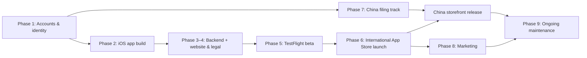

# Fable / Flow — Publishing & Maintenance Guide (International + Mainland China)

> **Brand setup:** umbrella **Fable Studio** at **`fablestudio.life`**; the app is **Fable / Flow**.
> **Owners:** 🧑 = you (accounts, IDs, payments, legal) · 🤖 = me (code, configs, docs, QA).
> Prices and rules were checked in October 2026 and change over time. ⚠️ marks items to re-verify at the moment you act.

---

## 0. Locked decisions

| Topic | Decision |
|---|---|
| Model | Free download → **14-day full trial** → free tier (**one card + one tomato**) or **Pro one-time ~$4.99–5.99** (≈ ¥25–30) |
| Extras | **Tip jar** (3 consumable tips); **50 founding beta users** get Pro via Offer Codes |
| Platforms | iPhone first (international + China), Android (Google Play) later, China Android only with a company |
| Domain / email | `fablestudio.life` (Alibaba or Tencent Cloud, real-name); `hello@fablestudio.life` + `support@`, `flow@` aliases |
| App web addresses | Website `flow.fablestudio.life` (or `fablestudio.life/flow`); China API `api-cn.fablestudio.life` |
| Backend | Hosted Supabase (international) + **self-hosted Supabase on a mainland server** (China), same code, data kept per region |
| Launch order | International (all storefronts **except mainland China and Russia**) → add mainland China when the App备案 number arrives |

---

## Phase 1 — Accounts, identity & brand (week 0–1)

### 1.1 Domain 🧑
1. Create an **Alibaba Cloud** (阿里云) or **Tencent Cloud** account and complete **individual real-name verification** with your Chinese ID. Use the **same provider** for the domain and the mainland server; it simplifies the filing.
2. Register **`fablestudio.life`** (~¥220/yr ⚠️). Turn on auto-renew.
3. Complete **domain real-name verification** (域名实名认证). Required before ICP filing; usually 1–3 days.

### 1.2 Email 🧑 (I can write the DNS records)
1. Subscribe to **iCloud+** (the 50 GB tier is enough; ~$0.99/mo, ¥6/mo in China).
2. Settings → your name → iCloud → **Custom Email Domain** → add `fablestudio.life` → Apple shows the DNS records (MX, SPF TXT, verification TXT, DKIM CNAME).
3. Add those records in the Alibaba/Tencent DNS console. Create `hello@`, `support@` and `flow@`.
4. Send a test from Gmail **and** from a Chinese mailbox (QQ / 163) to confirm delivery both ways.

### 1.3 Apple Developer Program 🧑
1. Enroll as an **Individual** ($99/yr; ¥688 if enrolled in mainland China) with **your legal name**. Use the **same legal name** as on your China ICP filing.
2. Your account's country determines tax forms and payouts: choose where your bank account and tax residency are.
3. **App Store Connect → Business:** sign the **Paid Applications Agreement**, fill in **tax** (W-9 if US; otherwise W-8BEN) and **banking**.
4. Apply to the **App Store Small Business Program** (15% commission instead of 30%).
5. **EU trader status (DSA):** you sell Pro and tips, so declare **Trader**. Apple publishes the address, phone and email on EU product pages.
   - Get a **P.O. box or virtual address** and a separate number (e.g. a VoIP line) beforehand, if you don't want your home details public.

### 1.4 Trademarks 🧑 (recommended; 🤖 can run the database search first)
- **China first:** China is first-to-file, so file **"Fable / Flow"** and the Chinese name in **class 9** (software) and optionally **class 42** (software services) with **CNIPA** (≈ ¥270–300 per class online ⚠️).
- **US:** USPTO class 9 (~$350 per class ⚠️) when budget allows.
- **Avoid plain "Fable"** as the trademarked mark: crowded name (Xbox game series, an existing book-club app).

**Phase 1 done when:** domain verified · email working · Apple account active with agreements/tax/bank · Small Business Program applied · trader address ready.

---

## Phase 2 — Build the iOS app (weeks 1–4) 🤖 (you test on your iPhone)

The web app is wrapped as a native iOS app with **Capacitor**, using the same code.

| # | Task | Notes |
|---|---|---|
| 2.1 | Capacitor iOS project; Bundle ID e.g. **`life.fablestudio.flow`** | Built in Xcode on your Mac |
| 2.2 | App icon set, launch screen, iPhone-only at first | iPad later |
| 2.3 | **StoreKit 2 purchases** | `Pro` (non-consumable), `Tip S/M/L` (consumables), **Restore Purchases** button |
| 2.4 | **Trial & free tier** | Trial start saved on device + account; after 14 days: one card + one tomato; older cards kept (never deleted) and unlocked with Pro |
| 2.5 | **Offer Codes** support | Redeem sheet for the 50 founding Pro codes |
| 2.6 | **Timer-end notification** | Local notification scheduled when a timer starts (the background-timer fix from v55 + a real lock-screen alert) |
| 2.7 | **Sign-in** | Email + Apple (+ Google internationally). Apple requires **in-app account deletion** for apps with accounts → add "Delete account & data" |
| 2.8 | **Data export** | GDPR-friendly "Export my data" (JSON / images) |
| 2.9 | **Region routing** | International ↔ China backend chosen at sign-up from the App Store country, with an option to change |
| 2.10 | **Privacy manifest** (`PrivacyInfo.xcprivacy`) | Required by Apple; declares data use and required-reason APIs |
| 2.11 | **Privacy-friendly analytics** | Retention day 1/7/14/30, trial → Pro conversion; no ad tracking (keeps "Data Not Linked to You" labels simple) |
| 2.12 | **China-specific UI** | First-launch privacy consent dialog (PIPL); filing number in About; Google sign-in hidden for China accounts |
| 2.13 | QA | Run `qa/run_qa.sh` on the web layer + a device checklist on your iPhone (purchases in the StoreKit sandbox, notifications, offline, sleep/wake) |

---

## Phase 3 — Backend (weeks 2–4)

### 3.1 International (hosted Supabase) 🤖 + 🧑 billing
1. **Upgrade to Pro ($25/mo) at launch.** The free plan pauses after 7 days without database activity; Pro adds daily backups.
2. Tables:
   - `fable_flow_user_state` (existing)
   - `entitlements` (pro, trial_started_at, region)
   - `purchases` (verified App Store transactions)
3. **Verify purchases** server-side via the App Store Server API, or use **RevenueCat** (unifies Apple/Google later).
4. **Account deletion endpoint:** deletes auth user + state + photos.

### 3.2 Mainland China (self-hosted Supabase): see Phase 7
It starts once the ICP filing is underway.

---

## Phase 4 — Website & legal pages (weeks 2–3) 🤖 (you review)

| Page | URL | Required for |
|---|---|---|
| Landing page (EN/中文) | `flow.fablestudio.life` | App Store "Marketing URL", press |
| **Privacy policy** (EN + 中文, says where data is stored per region) | `/privacy` | App Store, China filing, GDPR, PIPL |
| **Terms of use** | `/terms` | Purchases, EU |
| **Support** (contact `support@fablestudio.life`, FAQ, restore purchases, delete account) | `/support` | App Store "Support URL" |
| Studio page | `fablestudio.life` | Umbrella brand |

**Hosting:**
- **International:** GitHub Pages with the custom domain + free HTTPS.
- **China:** after ICP filing, mirror the site on the mainland server, since GitHub Pages is slow or unreliable inside China.

---

## Phase 5 — Beta with TestFlight (weeks 4–6)

1. 🤖 Upload builds from Xcode; 🧑 invite **internal testers** (up to 100, no review).
2. **External TestFlight** (up to 10,000; first build needs a short beta review) for your **50 founding users**: collect feedback in a simple form.
3. Track trial → Pro behavior with sandbox purchases.
4. **Exit criteria:** no crashes; purchases, restore, trial expiry, notifications and sync work in both regions; Chinese UI fits.

---

## Phase 6 — International App Store launch (week 6–7)

### 6.1 App Store Connect setup 🧑 (🤖 prepares all text/assets)

| Item | What to enter |
|---|---|
| App record | Name "Fable / Flow" (must be unique; have a backup like "Fable / Flow: Card & Timer"), subtitle, Bundle ID, SKU |
| Localizations | **English (US)** + **Chinese (Simplified)**: name, subtitle, description, keywords, What's New |
| Screenshots | Required largest iPhone size (6.9") ⚠️; 3–6 per language; optional preview video |
| Pricing | App free; in-app purchases: Pro ~$4.99–5.99 (Apple sets regional equivalents; set ¥25–30 for China manually); Tips $1.99 / $4.99 / $9.99 |
| Availability | **All countries except mainland China and Russia** (add China in Phase 7) |
| App Privacy | Data types collected (email, user content), linked to user, not used for tracking |
| Age rating | Questionnaire (likely 4+) |
| Export compliance | Uses only standard HTTPS → exempt |
| App Review notes | Demo account + how to test Pro (sandbox) and the timer |
| Contact | `support@fablestudio.life`; EU trader info verified |

### 6.2 Submit & release
1. Submit build + in-app purchases together (first-time IAPs are reviewed with the app).
2. Review typically takes 24–48 h. Fix any rejections, resubmit.
3. Use **manual release** so you control launch day; optionally **phased release** (7-day rollout).
4. After launch: generate **50 Offer Codes** for Pro and send them to the founding beta users.

---

## Phase 7 — China track (start in week 1, runs in parallel, ~3–6 weeks)

| # | Step | Owner | Time |
|---|---|---|---|
| 7.1 | Buy a **mainland server** at the same provider (Shanghai/Beijing region). Aim for 2 vCPU/4 GB for Supabase (~¥170–190 first year at Tencent ⚠️; Alibaba 2 vCPU/2 GB ¥99/yr same-price renewal, tight) | 🧑 | day 1 |
| 7.2 | **ICP filing for `fablestudio.life`** (individual): ID, face check in the provider's app, MIIT SMS verification within 24 h, provincial review. Describe it as a personal productivity tool. | 🧑 | 1–3 weeks |
| 7.3 | Install **self-hosted Supabase** (Docker), same schema/RLS; domestic email sender (DirectMail/SES) for auth mails; daily backups to OSS/COS; HTTPS cert for `api-cn.fablestudio.life` | 🤖 (you provide server access) | 2–3 days |
| 7.4 | **App备案** for Fable / Flow: app name, Bundle ID, iOS signing public key + SHA-1, backend domain `api-cn.fablestudio.life`, no third-party SDKs that need disclosure (or list them) | 🧑 (🤖 extracts cert values) | 1–3 weeks |
| 7.5 | China privacy policy (PIPL: purposes, data stored in China, how to delete, contact); first-launch consent dialog | 🤖 | — |
| 7.6 | App Store Connect: enter the **App备案 number** for the China storefront; Chinese metadata/screenshots; China price; **add mainland China to Availability**; submit an update | 🧑 | 1–2 days review |
| 7.7 | Show the filing number in the app (About) and on the China website footer | 🤖 | — |

**Keep it filing-safe:**
- no public user posts or comments
- no regulated categories (news, education, medical, finance)
- describe the app consistently everywhere (app name = filing name = store name)

---

## Phase 8 — Launch & marketing (from launch week)

| Channel | Action |
|---|---|
| App Store featuring | Submit **"Nominate for featuring"** in App Store Connect ~2–4 weeks before a notable release |
| English | Product Hunt launch, Reddit (r/productivity, r/iosapps, r/getdisciplined), a short demo video, personal network |
| Chinese | **小红书** (aesthetic posts: card + tomato), **少数派** article/listing, 即刻; CN screenshots in Chinese |
| Shareable moments | "Share today's card" image (Forest-style organic spread); possible future feature |
| Reviews | Gentle in-app review prompt (Apple's `requestReview`) after day 7 or a completed 14-card stack; never during focus |
| Press kit | Icon, screenshots, 1-paragraph story (Fable Studio), contact email |

---

## Phase 9 — Ongoing maintenance

### Weekly
- Read App Store reviews (reply to every one in the first months) and support email.
- Check crash reports (Xcode Organizer) and sales/trial conversion.

### Monthly
- Supabase usage and backups (international); mainland server health, disk, backups, OS security updates.
- Test a **restore from backup** every quarter.
- Regional pricing sanity check; Offer Code inventory.

### Each release
1. QA gate (impacted groups) + device checklist.
2. Bump version/build; What's New in EN + 中文.
3. TestFlight → submit → manual or phased release.
4. If the backend changes: run the migration on **both** Supabase copies.

### Yearly calendar

| When | Task |
|---|---|
| Spring (≈ April) ⚠️ | Apple usually starts requiring builds with the **latest Xcode/iOS SDK**: update and resubmit before the deadline |
| WWDC (June) | Plan support for the new iOS; test betas |
| Apple membership date | **Renew $99** (auto-renew on); expiry removes the app from sale |
| Domain date | Renew `fablestudio.life`. **An expired domain breaks email, website and the ICP filing.** |
| Server date | Renew the mainland server (an expired server can lead to filing problems) |
| Supabase / iCloud+ | Monthly billing; keep the card valid |
| Any time info changes | Update **EU trader info**, **ICP filing info** (address/phone/name), tax forms, bank |
| Trademarks | Track examination; respond to office actions; renew every 10 years (China/US) |

### Rules to keep
- **ICP:** the filed site/app must stay live and match the filing; change the filing before changing the app's nature or adding user-generated content.
- **Privacy:** honor delete/export requests (in-app tools cover most); update the privacy policy when data use changes.
- **Never delete user data on expiry** (trial or region moves). It's a core brand promise.

---

## Phase 10 — Android later (summary)

| Step | International | China |
|---|---|---|
| Account | Google Play Console **$25 one-time** | Per-store accounts (Huawei, Xiaomi, OPPO, vivo, 应用宝) |
| Gate | **12+ testers in a closed test for 14 consecutive days** (new personal accounts) | **软著** (software copyright certificate, ~1–2 months) + add Android to the App备案 |
| Payments | Google Play Billing (15%) | Paid apps / IAP mostly company-only → do China Android with a company |
| Shared | Same code (Capacitor Android), same backend, same account-based Pro | Same China backend |

---

## Timeline (realistic, solo + me)

| Week | International | China |
|---|---|---|
| 0–1 | Domain, email, Apple enrollment, agreements/tax/bank, trader address | Server purchase, **start ICP filing** |
| 1–4 | iOS build (Capacitor, purchases, trial, notifications, deletion, region routing) | ICP review; self-host Supabase |
| 2–4 | Backend Pro + entitlements; website & legal pages | — |
| 4–6 | TestFlight with 50 founding users | **App备案** (needs Bundle ID + cert) |
| 6–7 | **International launch** | App备案 review |
| 7–10 | Marketing, first update | **Add mainland China storefront** |
| Later | Android (Google Play) | China Android (company) |

## Yearly cost summary (approx.)

| Item | Per year |
|---|---|
| Apple Developer Program | $99 |
| fablestudio.life (Alibaba/Tencent) | ~$30 (¥220) |
| iCloud+ email | ~$12 |
| Hosted Supabase Pro | $300 |
| Mainland server + storage/email | ~$30–150 |
| EU trader address + phone (optional) | ~$70–260 |
| Trademarks (one-time, optional) | CN ≈ ¥300/class, US ≈ $350/class |
| **Running total** | **≈ $470–850 / year** + Apple's 15% of sales; Google Play +$25 once when Android ships |

---

## Your next three actions 🧑
1. Register **fablestudio.life** at Alibaba or Tencent Cloud and complete real-name verification.
2. Set up **hello@fablestudio.life** with iCloud+ (I'll give you the exact DNS records).
3. Enroll in the **Apple Developer Program**. Then I start Phase 2 (the iOS wrapper) on a new branch.
